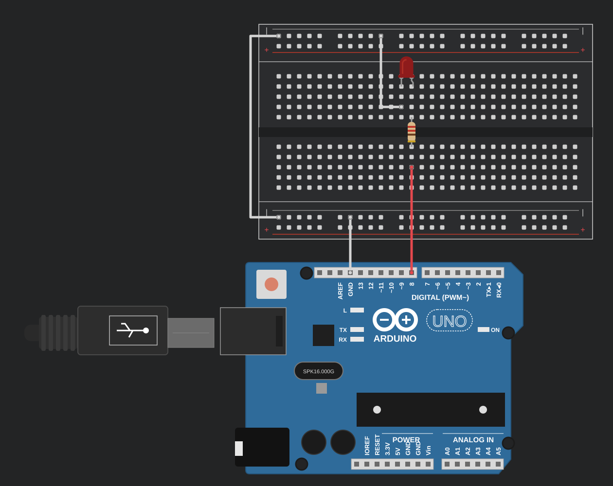
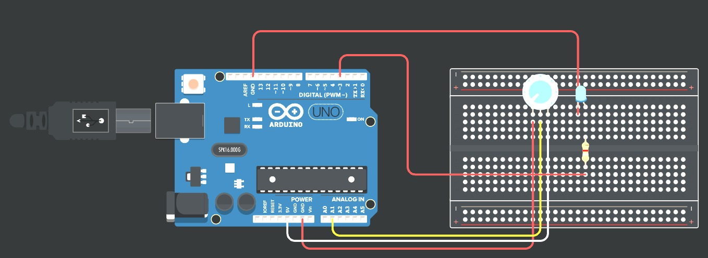
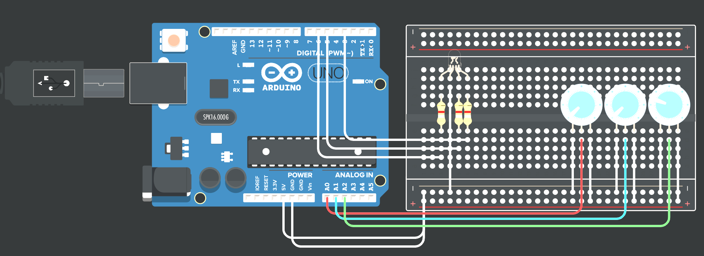

# learning-arduino

My Arduino lessons. Each lesson is one sketch in its own folder.

## Lessons

| Lesson | Sketch | What it shows | Serial baud |
|--------|--------|---------------|-------------|
| L1 | [L1-hello-world](L1-hello-world/L1-hello-world.ino) | `Serial` output, variables, `if/else`, `while` loop | 9600 |
| L2 | [L2-led-lamp](L2-led-lamp/L2-led-lamp.ino) | Blink one LED on pin 8 (1 s on, 1 s off) | 9600 |
| L3 | [L3-traffic-light](L3-traffic-light/L3-traffic-light.ino) | Traffic light: red 5 s, yellow blinks 3 s, green 4 s | 9600 |
| L4 | [L4-led-brightness-control](L4-led-brightness-control/L4-led-brightness-control.ino) | Potentiometer on A1 sets LED brightness on pin 3 (PWM) | 9600 |
| L5 | [L5-button-pull-down](L5-button-pull-down/L5-button-pull-down.ino) | Button on pin 2 (pull-down) turns on LED on pin 3; prints button state | 9600 |
| L6 | [L6-rgb-led](L6-rgb-led/L6-rgb-led.ino) | Three potentiometers (A0, A1, A2) set the red, blue and green brightness of an RGB LED (pins 6, 5, 3, PWM) | — |

## Circuits

Each lesson folder has a `circuit` image of its circuit.

### L1 – Hello World

No parts. Connect the board with the USB cable only.

### L2 – LED lamp

LED on pin 8, through a resistor to GND.

### L3 – Traffic light

Red LED on pin 11, yellow LED on pin 12, green LED on pin 13. Each LED goes through a resistor to GND.

### L4 – LED brightness control

Potentiometer middle pin on A1, outer pins on 5V and GND. LED on pin 3, through a resistor to GND.

### L5 – Button pull-down

Button between 5V and pin 2. Pull-down resistor (for example 10 kΩ) from pin 2 to GND. LED on pin 3, through a resistor to GND.

### L6 – RGB LED

Common-cathode RGB LED. Long leg on GND. Red leg on pin 6, green leg on pin 3, blue leg on pin 5. Each color leg goes through a resistor. Three potentiometers: middle pins on A0 (red), A1 (blue) and A2 (green), outer pins on 5V and GND.

## How to run

1. Open the `.ino` file in the Arduino IDE.
2. Select your board and port.
3. Click **Upload**.
4. Open the Serial Monitor and set the baud rate from the table.
