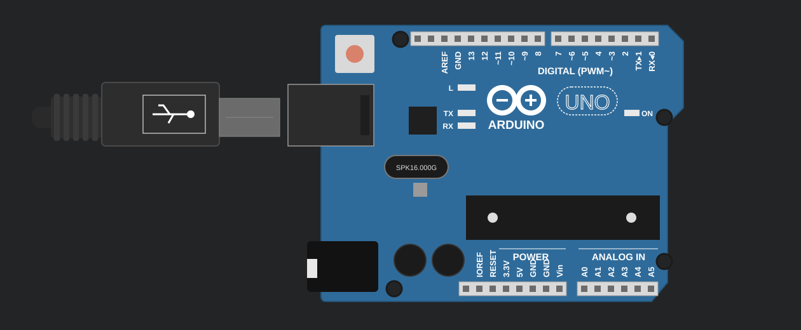
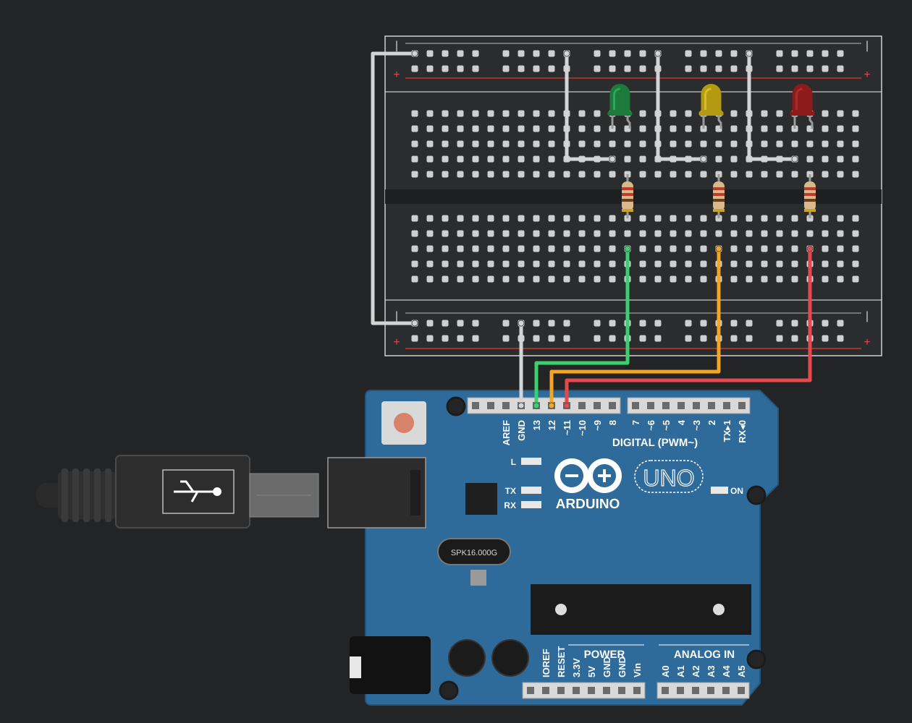
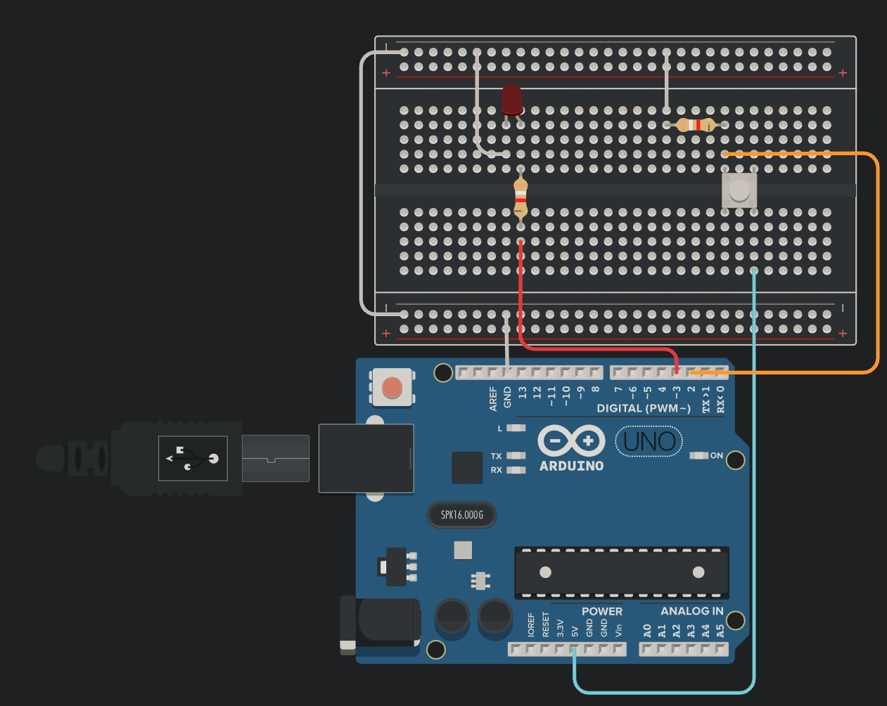
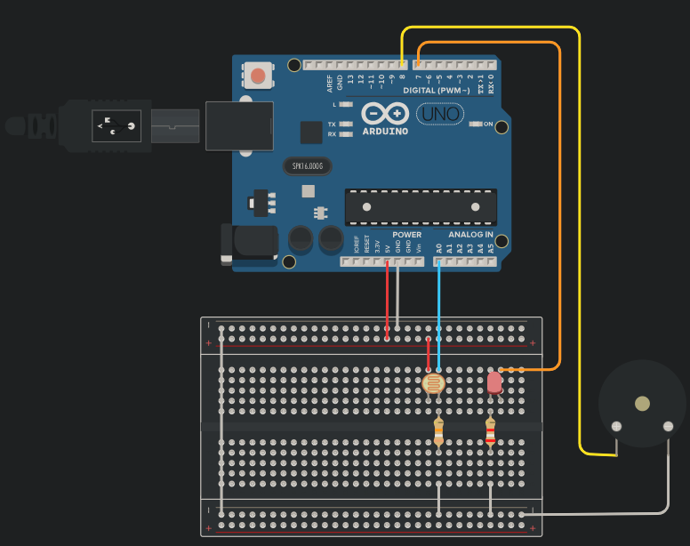

# learning-arduino

My Arduino lessons. Each lesson is one sketch in its own folder.

## Lessons

| Lesson | Sketch | What it shows | Serial baud |
|--------|--------|---------------|-------------|
| L1 | [L1-hello-world](L1-hello-world/L1-hello-world.ino) | `Serial` output, variables, `if/else`, `while` loop | 9600 |
| L2 | [L2-led-lamp](L2-led-lamp/L2-led-lamp.ino) | Blink one LED on pin 8 (1 s on, 1 s off) | 9600 |
| L3 | [L3-traffic-light](L3-traffic-light/L3-traffic-light.ino) | Traffic light: red 5 s, yellow blinks 3 s, green 4 s | 9600 |
| L4 | [L4-led-brightness-control](L4-led-brightness-control/L4-led-brightness-control.ino) | Potentiometer on A1 sets LED brightness on pin 3 (PWM) | 9600 |
| L5 | [L5-button-pull-down](L5-button-pull-down/L5-button-pull-down.ino) | Button on pin 2 (pull-down) turns on LED on pin 3; prints button state | 9600 |
| L6 | [L6-rgb-led](L6-rgb-led/L6-rgb-led.ino) | Three potentiometers (A0, A1, A2) set the red, blue and green brightness of an RGB LED (pins 6, 5, 3, PWM) | — |
| L7 | [L7-laser-alarm](L7-laser-alarm/L7-laser-alarm.ino) | Laser alarm: laser (pin 7) shines on an LDR (A0); if the beam breaks, the buzzer (pin 8) sounds | 9600 |

## Circuits

Each lesson folder has a `circuit` image of its circuit.

### L1 – Hello World

No parts. Connect the board with the USB cable only.

### L2 – LED lamp

LED on pin 8, through a resistor to GND.

### L3 – Traffic light

Red LED on pin 11, yellow LED on pin 12, green LED on pin 13. Each LED goes through a resistor to GND.

### L4 – LED brightness control

Potentiometer middle pin on A1, outer pins on 5V and GND. LED on pin 3, through a resistor to GND.

### L5 – Button pull-down

Button between 5V and pin 2. Pull-down resistor (for example 10 kΩ) from pin 2 to GND. LED on pin 3, through a resistor to GND.

### L6 – RGB LED

Common-cathode RGB LED. Long leg on GND. Red leg on pin 6, green leg on pin 3, blue leg on pin 5. Each color leg goes through a resistor. Three potentiometers: middle pins on A0 (red), A1 (blue) and A2 (green), outer pins on 5V and GND.

The pin wires in the image have the color of the LED leg they drive.

| LED leg (left to right, in Tinkercad) | Connects to |
|---------------------------------------|-------------|
| 1 – red | resistor → pin 6 |
| 2 – common cathode (longest) | GND |
| 3 – blue | resistor → pin 5 |
| 4 – green | resistor → pin 3 |

> **Note:** This leg order is for the Tinkercad RGB LED. A real RGB LED can have a different order. Many common-cathode LEDs use red, cathode, green, blue, but it changes between makers and batches. Before you wire a real LED, find the longest leg (cathode, to GND). Then touch each other leg to 5V through a resistor and see which color it lights. Connect each color to its pin in the code.

### L7 – Laser alarm

LDR between 5V and A0. Resistor (for example 10 kΩ) from A0 to GND. Laser on pin 7, through a resistor to GND. Buzzer between pin 8 and GND.

In Tinkercad, a red LED is the laser.

How it works:

1. At start, the laser turns on.
2. When the LDR value goes above `THRESHOLD` (500), the beam is on the LDR. The system arms and prints `Sistem aktivdir`.
3. If the system is armed and the value falls to `THRESHOLD` or below, the beam is broken. The buzzer plays 1000 Hz and the Serial Monitor prints the value and `MANEE!`.
4. When the beam comes back, the buzzer stops.

> **Note:** Set `THRESHOLD` for your room light. Read the A0 value with the beam on and with the beam blocked. Use a value between the two.

## How to run

1. Open the `.ino` file in the Arduino IDE.
2. Select your board and port.
3. Click **Upload**.
4. Open the Serial Monitor and set the baud rate from the table.
