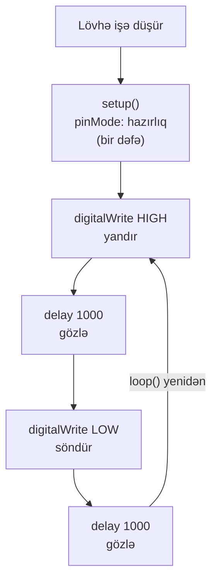

# Dərs 1 — Robot beyni: L işığı yanıb-sönür

**Bir fikir:** Əmrlər sıra ilə gedir. `setup()` bir dəfə işləyir. `loop()` dayanmadan təkrarlanır.

**Lazımdır:** KEYESTUDIO UNO, USB kabel. Başqa heç nə.



## Necə işlətmək
1. USB kabeli kompüterə və lövhəyə tax.
2. Arduino IDE-də `D01-robot-beyni.ino` faylını aç.
3. Lövhə: **Arduino Uno**. Port: lövhənin portu.
4. **Upload** (→) düyməsini bas.
5. Lövhədə **L** işığına bax: 1 saniyə yanır, 1 saniyə sönür.

## Təxmin et → Yoxla
Hər dəyişiklikdən əvvəl nəticəni təxmin et. Sonra yüklə və yoxla.

| № | Dəyişiklik | Təxmin |
|---|---|---|
| 1 | İki `delay(1000)`-i `delay(200)` et | ? |
| 2 | Yandırdan sonra `delay(100)`, söndürdən sonra `delay(1000)` | ? |
| 3 | Sonuncu `delay(1000)` sətrini sil | ? |
| 4 | USB-ni kompüterdən çıxar, telefon adapterinə tax | ? |

<details>
<summary>Cavablar</summary>

1. İşıq tez-tez yanıb-sönür.
2. Qısa parıltı, uzun qaranlıq — mayak kimi.
3. İşıq həmişə yanır kimi görünür. Söndürdən dərhal sonra `loop()` yenidən başlayır və işığı yandırır. Göz bu qısa sönməni görmür.
4. İşıq yenə yanıb-sönür. Proqram lövhənin yaddaşında qalır. Kompüter yalnız yükləmək üçün lazımdır.
</details>

## Bonus: Ürək döyüntüsü
L işığı ürək kimi döyünsün: qısa yanma, qısa fasilə, qısa yanma, uzun fasilə.
Yalnız bu dərsin əmrlərini istifadə et.

<details>
<summary>Bir həll</summary>

```cpp
void loop() {
  digitalWrite(LED_BUILTIN, HIGH);
  delay(100);
  digitalWrite(LED_BUILTIN, LOW);
  delay(100);
  digitalWrite(LED_BUILTIN, HIGH);
  delay(100);
  digitalWrite(LED_BUILTIN, LOW);
  delay(700);
}
```
</details>
